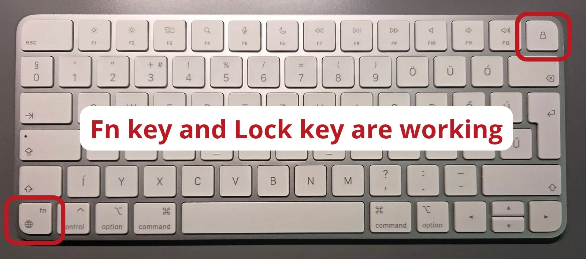
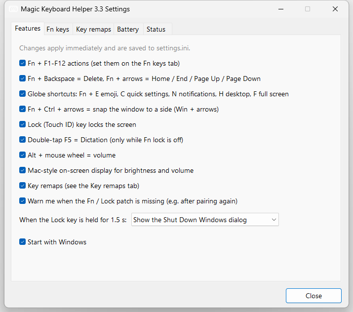
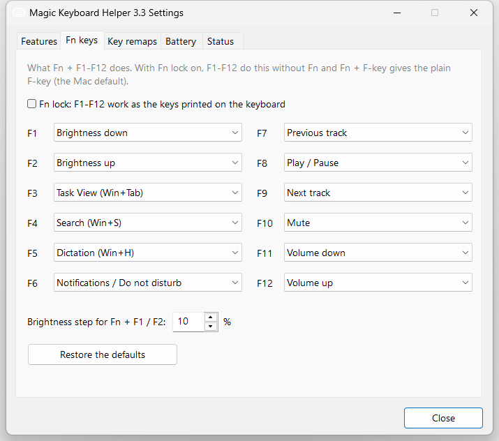
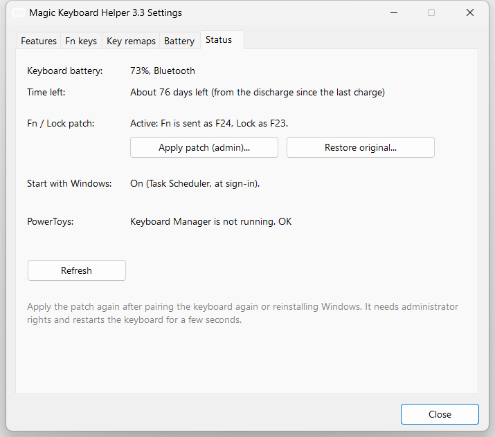
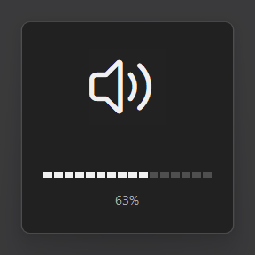

# Magic Keyboard Helper for Windows

Makes the **Apple Magic Keyboard with Touch ID (A2449)** work properly on Windows 11 over Bluetooth, **including the Fn (globe) key and the Lock (Touch ID) key**, without a kernel driver and without paid software.

> Not affiliated with or endorsed by Apple Inc. "Apple", "Magic Keyboard" and "Touch ID" are trademarks of Apple Inc.

**[Download the latest version](https://github.com/Mrlouder/magic-keyboard-helper-windows/releases/latest)**

## Supported keyboards

| Model | Name | Status |
|---|---|---|
| **A2449** | Magic Keyboard with Touch ID (without numeric keypad), Lightning | **Supported**, tested over Bluetooth, any language layout |
| A2520 | Magic Keyboard with Touch ID and Numeric Keypad | Not yet |
| A2450 | Magic Keyboard without Touch ID (2021) | Not yet |
| A1644 / A1843 | Older Magic Keyboard / with Numeric Keypad | Not yet |
| 2024 USB-C models | Magic Keyboard (USB-C) | Not tested |

The model number is printed on the bottom of the keyboard. Other models are not recognized yet: the Fn / Lock patch looks for the A2449 only (vendor ID `0x004C`, product ID `0x029C`). If you have another model and want to help, please open an issue.

## Features

- **Fn + F1-F12:** the functions printed on the keys (brightness of the laptop screen and of external monitors, Task View, search, dictation, media, volume). Each one can be changed on the Settings > Fn keys tab.
- **Fn lock:** F1-F12 give the printed functions without Fn, and Fn + F-key gives the plain F-key (like the Mac default).
- **Globe shortcuts:** Fn + E emoji, C quick settings, N notifications, H desktop, F full screen.
- **Fn + Backspace / arrows:** Delete, Home / End / Page Up / Page Down. **Fn + Ctrl + arrows** snap the window (Win + arrows).
- **Lock (Touch ID) key:** a short press locks the screen. Holding it for 1.5 s shows the Shut Down Windows dialog, shuts down, sleeps or turns the display off (you choose).
- **Mac-style on-screen display** for brightness and volume (16 steps, without the Windows volume flyout).
- **Battery level** in the tray, time-left estimate, low battery reminders, charging icon. No extra software needed.
- **Key remaps** (replaces PowerToys Keyboard Manager), stored by physical key, so they work with any Windows keyboard layout. One-click **Apple ISO key fix** for UK / German / Hungarian etc. keyboards.
- **Patch watch:** tells you if the Fn / Lock patch is lost (e.g. after pairing the keyboard again) and applies it with one click.
- **Alt + mouse wheel** = volume. **Double-tap F5** = dictation (optional).

Everything can be switched on or off in the Settings window (double-click the tray icon).

## Screenshots

| Settings: Features | Settings: Fn keys |
|---|---|
|  |  |

| Settings: Status | Volume on-screen display |
|---|---|
|  |  |

## Requirements

| | |
|---|---|
| Keyboard | Apple Magic Keyboard with Touch ID, model **A2449**, connected over **Bluetooth** (see Supported keyboards) |
| Windows | Windows 11 (Windows 10 will probably work, not tested) |
| AutoHotkey | Included in the download. When running from the source code: [AutoHotkey v2](https://www.autohotkey.com/) |
| Brightness keys | Laptop / tablet built-in screens, and external monitors with DDC/CI support (most of them) |

## Installation

1. Pair the keyboard with Windows over Bluetooth.
2. Download **`MagicKeyboardHelper-v….zip`** from the [latest release](https://github.com/Mrlouder/magic-keyboard-helper-windows/releases/latest).
3. Unzip it to a permanent place, e.g. `Documents\MagicKeyboardHelper`. The app keeps its settings in this folder, so do not run it from inside the zip or from the Downloads folder you clean up.
4. Double-click **`MagicKeyboardHelper.bat`**. The keyboard icon appears in the tray (it may be hidden under the `^` arrow). If Windows SmartScreen warns about the file, click "More info" > "Run anyway".
5. Apply the **Fn / Lock patch**: Settings > Status > `Apply patch (admin)...`, or click the notification the app shows. It asks for administrator rights and restarts the keyboard for a few seconds.
6. **Apple ISO keyboards** (UK, German, Hungarian, Nordic etc., with the tall Enter key): if the key left of 1 and the key next to the left Shift are swapped, click Settings > Key remaps > `Apple ISO key fix`. US (ANSI) keyboards do not need this.

**Start with Windows** is on by default (Settings > Features): on its first start the app creates a Task Scheduler task named "Magic Keyboard Helper" that starts it when you sign in (for your user account only, no administrator rights needed). If you move the folder, start the app once from the new place and the task follows it.

**Update:** close the app (tray icon > Exit), unzip the new version over the old folder (your `settings.ini` and patch backup stay), start it again.

**Uninstall:** Settings > Status > `Restore original...` (undoes the Fn / Lock patch), untick Settings > Features > Start with Windows, Exit, then delete the folder.

**From the source code:** install [AutoHotkey v2](https://www.autohotkey.com/) (or copy its `AutoHotkey64.exe` into the folder), clone or download this repository, and start `MagicKeyboardHelper.bat`.

If you use PowerToys Keyboard Manager, its single key remaps are imported on the first start. Turn Keyboard Manager off afterwards, otherwise the remaps are applied twice.

## Default key map

| Keys | Action |
|---|---|
| Fn + F1 / F2 | Brightness down / up (laptop screen and DDC/CI monitors) |
| Fn + F3 | Task View (Win + Tab) |
| Fn + F4 | Search (Win + S) |
| Fn + F5 | Dictation (Win + H) |
| Fn + F6 | Notifications / Do not disturb (Win + N) |
| Fn + F7 / F8 / F9 | Previous / Play-Pause / Next |
| Fn + F10 / F11 / F12 | Mute / Volume down / Volume up |
| Fn + E / C / N / H / F | Emoji / Quick settings / Notifications / Desktop / Full screen |
| Fn + Backspace | Delete |
| Fn + arrows | Home / End / Page Up / Page Down (with Shift: select) |
| Fn + Ctrl + arrows | Snap the window (Win + arrows) |
| Lock key, short / held 1.5 s | Lock the screen / Shut Down Windows dialog (configurable) |
| Alt + mouse wheel | Volume |

Modifier combinations such as Alt + F4 and Ctrl + F5 always keep their normal meaning.

Tip: "Switch audio output" is one of the Fn-key actions. It sends Alt + F6, the hotkey you can set in [SoundSwitch](https://soundswitch.aaflalo.me/) (Windows has no built-in hotkey for this).

## How the Fn and Lock keys work without a driver

The keyboard sends the Fn key as a vendor-specific HID usage (`0xFF01/0x03`) and the Lock key as Consumer `0x019E` (AL Terminal Lock). The Windows keyboard driver drops both, so normally no program can see them.

For Bluetooth devices Windows caches the device's HID report descriptor in the registry:
`HKLM\SYSTEM\CurrentControlSet\Services\BTHPORT\Parameters\Devices\<MAC>\CachedServices`

`fn_lock_patch.ps1` rewrites 20 bytes of this descriptor in place (same length), so the keyboard's own reports are read differently:

| Key | Original usage | New usage |
|---|---|---|
| Fn (globe) | `0xFF01/0x03` (vendor) | Keyboard `0x07/0x73` = **F24** |
| Lock (Touch ID) | Consumer `0x019E` | Keyboard `0x07/0x72` = **F23** |

The app then handles F24 and F23 combinations.

- The original descriptor is saved to `sdp_backup_<MAC>.reg` on the first run. Undo: Settings > Status > `Restore original...` or `fn_lock_patch.bat -Restore`. Removing the keyboard in Bluetooth settings and pairing it again also restores the original.
- Pairing the keyboard again (or reinstalling Windows) removes the patch. The app notices this and offers to apply it again.
- If the expected bytes are not found, the script changes nothing.

**This edits the registry with administrator rights. Use it at your own risk.** It was tested on one A2449 (Hungarian layout) with Windows 11.

## Battery

The keyboard reports its battery on a vendor HID collection (`0xFF00/0x14`) in input report `0x90`: byte 1 = flags (bit0 external power, bit1 charging, bit2 fully charged), byte 2 = percent. Unlike the keyboard collection, this one can be read from user mode, so no driver is needed. The keyboard also sends this report by itself when the level or the charging state changes.

## Limitations

- **Touch ID** fingerprint reading does not work on Windows (it needs Apple's Secure Enclave). The key works as a Lock key.
- **USB cable:** when the keyboard is plugged into the PC with a cable it switches to USB mode, and there the Fn and Lock keys cannot be fixed (USB devices have no descriptor cache in the registry). The battery still works. On a wall charger the keyboard stays on Bluetooth and everything works.
- **Brightness:** built-in screens through Windows (WMI), external monitors only with DDC/CI. The laptop screen support has not been tested on many laptops yet.

## Files

| File | |
|---|---|
| `MagicKeyboardHelper.bat` | Starts the app (portable `AutoHotkey64.exe` in this folder, or installed AutoHotkey v2) |
| `magic_keyboard_media.ahk` | The app (AutoHotkey v2) |
| `fn_lock_patch.bat` / `.ps1` | Fn / Lock patch, `-Restore` to undo |
| `magic_keyboard*.ico`, `make_icon.py` | Tray icons and their generator (Python stdlib only) |
| `settings.ini` | Your settings, created by the app (not in the repository) |
| `sdp_backup_<MAC>.reg` | Backup of the original descriptor, created by the patch (not in the repository, keep it) |
| `error.log` | Only created if something goes wrong |
| `CHANGELOG.md` | Version history |
| `tools/make_release.py` | Builds the release zip (downloads the pinned AutoHotkey v2 runtime and checks its SHA-256) |
| `.github/workflows/release.yml` | Pushing a `v*` tag builds the zip and publishes the GitHub release |

## Why not a compiled .exe?

Windows Defender's machine-learning scanner flagged compiled builds of this script (a new, unknown file with a keyboard hook and autostart) as malware, a false positive, and deleted them. The unchanged, widely known AutoHotkey runtime is not flagged, so the app runs as a script.

## License

[MIT](LICENSE). The release zip also contains the unchanged AutoHotkey v2 runtime (`AutoHotkey64.exe`), which is licensed under the GNU GPL v2 (see `AutoHotkey-LICENSE.txt` and `THIRD-PARTY.txt` in the zip).

## Credits

Developed with the help of [Claude Code](https://claude.com/claude-code) (Anthropic).
